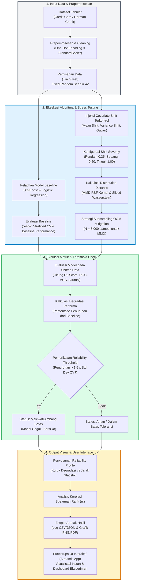

# Framework Stress Testing untuk Evaluasi Ketahanan Model Machine Learning terhadap Perubahan Distribusi Data Secara Terkontrol
*(Development of a Stress Testing Framework for Evaluating Machine Learning Model Robustness Under Controlled Data Distribution Shifts)*

[]()
[]()
[]()

Repositori ini memuat perangkat lunak framework penelitian kuantitatif eksperimental yang mengimplementasikan metodologi **Stress Testing Terkontrol** untuk model *supervised machine learning* (klasifikasi tabular) saat menghadapi *distribution shift* (khususnya *covariate shift*).

---

## 1. Alur Eksperimen End-to-End



---

## 2. Struktur Modul & Arsitektur

```
Sempro-TA/
├── framework/
│   ├── config.py              # Definisi Enums, Dataclasses, dan Threshold Policy
│   ├── dataset/
│   │   ├── validator.py       # Validasi integritas & missingness data tabular
│   │   ├── preprocessor.py    # Preprocessing bebas data leakage (fit strictly on train)
│   │   └── loader.py          # Benchmark generator & stratified split
│   ├── shift/
│   │   └── generator.py       # Skenario Mean Shift, Variance Shift, Outlier Ingestion
│   ├── distance/
│   │   ├── mmd.py             # Unbiased MMD^2 (RBF Kernel, Median Heuristic, OOM Cap)
│   │   └── wasserstein.py     # Sliced Wasserstein Distance (SWD) & Univariate EMD
│   ├── models/
│   │   ├── baseline.py        # Pelatihan Logistic Regression & XGBoost (5-Fold CV)
│   │   └── evaluator.py       # Metrik F1, ROC-AUC, Accuracy, Precision, Recall
│   ├── reliability/
│   │   ├── degradation.py     # Kalkulasi degradasi absolut & relatif
│   │   ├── threshold.py       # Dynamic Reliability Threshold (1.5x Std Dev CV)
│   │   ├── correlation.py     # Spearman Rank Correlation (rs & p-value)
│   │   └── profile.py         # Reliability Profile assembler & exporter (CSV, JSON, MD)
│   └── pipeline.py            # Orchestrator alur stress testing end-to-end
├── tests/                     # 17 Unit & Integration Tests (100% Passing)
│   ├── test_preprocessor.py
│   ├── test_shift.py
│   ├── test_distance.py
│   ├── test_degradation.py
│   ├── test_spearman.py
│   └── test_pipeline.py
├── output/                    # Hasil ekspor benchmark publikasi
│   ├── reliability_profile.csv
│   ├── reliability_profile.json
│   ├── executive_summary.md
│   ├── severity_vs_performance.png
│   ├── distance_vs_degradation.png
│   └── threshold_breach_matrix.png
├── app.py                     # Purwarupa antarmuka interaktif Streamlit (7 Halaman)
├── run_experiments.py         # CLI runner untuk eksekusi headless batch eksperimen
└── README.md
```

---

## 3. Metodologi dan Formulasi Kunci

### 3.1 Prapemrosesan Tanpa Kebocoran Informasi (*Zero Data Leakage*)
Imputer (`SimpleImputer`), Scaler (`StandardScaler`), dan Encoder (`OneHotEncoder`) di-*fit* **secara ketat hanya pada data training**:
$$\hat{\mu}_{\text{train}}, \hat{\sigma}_{\text{train}} = \text{Fit}(X_{\text{train}})$$
$$X_{\text{test}}^{\text{proc}} = \text{Transform}(X_{\text{test}}, \hat{\mu}_{\text{train}}, \hat{\sigma}_{\text{train}})$$
$$X_{\text{shift}}^{\text{proc}} = \text{Transform}(X_{\text{shift}}, \hat{\mu}_{\text{train}}, \hat{\sigma}_{\text{train}})$$

### 3.2 Maximum Mean Discrepancy (MMD)
Menggunakan estimator tak-bias ($U$-statistic) untuk $\text{MMD}^2$ dengan RBF Gaussian Kernel:
$$\text{MMD}^2(X, Y) = \frac{1}{n(n-1)} \sum_{i \neq j} k(x_i, x_j) + \frac{1}{m(m-1)} \sum_{i \neq j} k(y_i, y_j) - \frac{2}{nm} \sum_{i, j} k(x_i, y_j)$$
dengan pemilihan bandwidth median heuristic $\sigma = \text{median}(\|z_i - z_j\|)$ dan mitigasi subsampling $N = 5{,}000$ untuk mencegah OOM.

### 3.3 Dynamic Reliability Threshold
Batas toleransi dinamis ditentukan dari variabilitas model pada data training saat validasi silang (5-Fold Stratified CV):
$$\text{Threshold} = 1.5 \times \sigma_{\text{CV}}$$
$$\text{Status} = \begin{cases} 
\text{Melewati Ambang Batas (Model Gagal / Berisiko)}, & \text{jika } \Delta_{\text{abs}} > 1.5 \times \sigma_{\text{CV}} \\ 
\text{Aman / Dalam Batas Toleransi}, & \text{jika } \Delta_{\text{abs}} \le 1.5 \times \sigma_{\text{CV}} 
\end{cases}$$

---

## 4. Cara Menjalankan Sistem

### 4.1 Menjalankan Pengujian Otomatis (*Unit & Integration Tests*)
```bash
python3 -m pytest tests/ -v
```

### 4.2 Menjalankan Eksperimen Benchmark Lengkap (Headless CLI)
```bash
python3 run_experiments.py
```
Perintah ini akan menjalankan eksperimen 18 kondisi shift, melatih model baseline, menghitung 5-fold CV, mengevaluasi MMD & Wasserstein, menghitung korelasi Spearman, serta mengekspor artefak tabel dan grafik publikasi ke direktori `output/`.

### 4.3 Menjalankan Antarmuka Interaktif Web (Streamlit App)
```bash
streamlit run app.py
```
Aplikasi memuat 7 halaman interaktif:
1. **Dataset Management** (Upload CSV, inspeksi tipe data, missingness).
2. **Experiment Configuration** (Stratified split, pemilihan model, seed = 42).
3. **Shift Configuration** (Mean Shift, Variance Shift, Outlier Shift, KDE preview).
4. **Distribution Distance** (Kalkulasi MMD & Wasserstein, bar chart perbandingan).
5. **Model Evaluation** (Pelatihan 5-fold CV, evaluasi baseline vs shifted, degradasi performa).
6. **Reliability Analysis** (Dynamic threshold check, scatter plot, kurva severity).
7. **History & Export** (Unduh CSV, JSON, Markdown).

---

## 5. Ringkasan Temuan Empiris Utama

Berdasarkan eksekusi eksperimen pada dataset benchmark:
- **Logistic Regression:**
  - Korelasi MMD vs F1 Degradation: $r_s = 0.7167$ ($p = 0.0298$, signifikan).
  - Korelasi Wasserstein vs F1 Degradation: $r_s = 0.6667$ ($p = 0.0499$, signifikan).
- **XGBoost:**
  - Korelasi MMD vs F1 Degradation: $r_s = 0.5167$ ($p = 0.1544$).
  - Korelasi Wasserstein vs F1 Degradation: $r_s = 0.1833$ ($p = 0.6368$, tidak signifikan).

Temuan ini membuktikan secara ilmiah (**RQ3**) bahwa **besar perbedaan distribusi (MMD / Wasserstein) tidak selalu berkorelasi linier atau kuat dengan degradasi performa**. Ketahanan model sangat bergantung pada arsitektur model (model pohon non-linier seperti XGBoost memiliki batas keputusan bertingkat yang bereaksi berbeda dibanding model linier terhadap pergeseran lokasi dan skala fitur).
